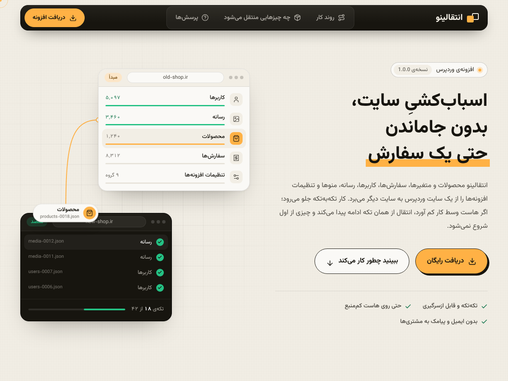

# قالب لندینگ انتقالینو

قالب وردپرس صفحه‌ی معرفی **انتقالینو**؛ افزونه‌ای که محصولات، سفارش‌ها، کاربرها، رسانه و تنظیمات یک سایت وردپرس و ووکامرس را تکه‌به‌تکه و قابل ازسرگیری به سایت دیگر منتقل می‌کند.



## امکانات

- هیرو با انیمیشن انتقال داده از سایت مبدأ به سایت مقصد
- روند هفت‌ایستگاهی با متن اسکرولی و صحنه‌ی چسبان
- ورود سکشن‌ها هم‌جهت با اسکرول و نشانگر ماوس اختصاصی (روی دستگاه‌های لمسی غیرفعال)
- فونت وزیرمتن (نسخه‌ی متغیر، داخل خود قالب؛ بدون درخواست به سرور بیرونی)
- راست‌چین، واکنش‌گرا و سازگار با `prefers-reduced-motion`
- برگه‌ها و نوشته‌های معمولی هم با همان سربرگ و پانویس نمایش داده می‌شوند

## نصب

1. از همین مخزن، **Code › Download ZIP** را بگیرید.
2. در پیشخوان وردپرس به **نمایش › پوسته‌ها › افزودن › بارگذاری پوسته** بروید و فایل ZIP را بارگذاری و فعال کنید.
3. در **تنظیمات › خواندن**، صفحه‌ی اول را روی «آخرین نوشته‌ها» یا یک برگه‌ی ایستا بگذارید؛ در هر دو حالت صفحه‌ی اول لندینگ را نشان می‌دهد.

> اگر نام پوشه‌ی داخل ZIP شبیه `Enteghalino-main` بود، مشکلی نیست؛ وردپرس آن را به‌عنوان پوسته می‌شناسد.

## تنظیمات

همه‌ی متن‌ها، لینک‌ها و رنگ‌های صفحه‌ی اول در **نمایش › سفارشی‌سازی › لندینگ انتقالینو** هستند. با باز کردن هر بخش، پیش‌نمایش به همان قسمت صفحه می‌رود و بیشتر تغییرها بدون بارگذاری دوباره دیده می‌شوند.

| بخش | چه چیزهایی |
|---|---|
| عمومی | نام برند، نسخه، لینک دریافت، توضیح سئو، نشانگر ماوس و انیمیشن ورود سکشن‌ها |
| رنگ‌ها | رنگ اصلی (پیش‌فرض `#ffb145`)، رنگ دوم (`#24c184`)، زمینه و متن |
| سربرگ و منو | سه پیوند منو، متن و لینک دکمه |
| هیرو | برچسب، سه خط عنوان، متن معرفی، دو دکمه، ویژگی‌ها، دامنه‌های مبدأ و مقصد |
| نوار متحرک | موارد نوار |
| روند کار | عنوان بخش و متن، نکته‌ها و نام کوتاه هر هفت ایستگاه |
| فهرست بار | عنوان، دو ستون فهرست، یادداشت |
| عددها | چهار کارت با آیکون، عدد، واحد و توضیح |
| پرسش‌های پرتکرار | تا ۸ پرسش و پاسخ |
| دعوت به نصب | عنوان، دکمه، نیازمندی‌ها، دو قدم و نکته |
| پانویس | نام و لینک سازنده، متن اضافه |

هر بخش (به‌جز هیرو) گزینه‌ی «نمایش این بخش» دارد. پیوندها و دکمه‌هایی که به بخش پنهان می‌روند خودکار پنهان می‌شوند.

**قاعده‌های متن:**

- `*متن*` بخشی را برجسته (رنگی) می‌کند؛ مثل `در *هفت ایستگاه*`.
- در قدم‌های بخش پایانی، `[متن]` به شکل دکمه نمایش داده می‌شود.
- در فیلدهای چندخطی هر خط یک مورد است؛ در فهرست بار به شکل `عنوان | توضیح`.
- عبارت‌های لاتین مثل `PHP 7.4+` خودکار جدا می‌شوند تا در متن راست‌چین به‌هم نریزند.
- لینک‌ها می‌توانند نشانی کامل باشند یا لنگر بخش‌ها: `#get`، `#story`، `#manifest`، `#faq`.

**رنگ‌ها:** فقط چهار رنگ پایه انتخاب می‌شوند. نسخه‌ی تیره‌تر برای متن، سایه‌ی کم‌رنگ و رنگ متن روی دکمه از روی آن‌ها ساخته می‌شود و کنتراست متن حداقل ۴٫۵ می‌ماند.

**منو:** اگر در **نمایش › فهرست‌ها** منویی به جایگاه «منوی بالای لندینگ» بدهید، به‌جای سه پیوند پیش‌فرض نمایش داده می‌شود. منو یک‌سطحی است.

تصویرهای متحرک داخل هیرو و هفت ایستگاه (اعداد نمونه، نام فایل‌ها) ثابت‌اند و در قالب `template-parts/landing/` قرار دارند.

## ساختار

```
front-page.php              صفحه‌ی اول: سکشن‌های لندینگ به ترتیب
index.php                   برگه‌ها، نوشته‌ها، بایگانی‌ها و ۴۰۴
header.php / footer.php     سربرگ، منو و پانویس
functions.php               بارگذاری فایل‌ها، رنگ‌ها، منو و head
inc/options.php             فهرست همه‌ی تنظیمات و پیش‌فرض‌ها، قالب‌بندی متن، ساخت پالت رنگ
inc/customizer.php          ساخت پنل سفارشی‌سازی از روی inc/options.php
inc/class-heading-control.php  عنوان‌های میان‌بخشی در پنل
template-parts/icons.php    آیکون‌ها (SVG sprite)
template-parts/sec-head.php سرتیتر مشترک سکشن‌ها
template-parts/landing/     hero، ticker، story، manifest، numbers، faq، cta
assets/css/landing.css      همه‌ی استایل‌ها
assets/js/landing.js        منو، انیمیشن هیرو، صحنه‌ها، ورود سکشن‌ها، نشانگر ماوس
assets/js/customizer-*.js   پیش‌نمایش زنده و پرش به بخش در سفارشی‌سازی
assets/fonts/               وزیرمتن متغیر + مجوز OFL
```

برای افزودن یک تنظیم تازه، فقط کافی است آن را در `enteghalino_schema()` تعریف کنید و در قالب با `enteghalino_e( 'key' )` چاپ کنید؛ پنل و پیش‌نمایش زنده خودکار ساخته می‌شوند.

## نیازمندی‌ها

وردپرس ۶٫۳ به بالا و PHP ۷٫۴ به بالا.

## مجوز

قالب: GPLv2 یا بالاتر. فونت وزیرمتن: SIL Open Font License 1.1 (فایل `assets/fonts/OFL.txt`).

ساخته‌ی [تیم پیکسی](https://github.com/pixitm).
